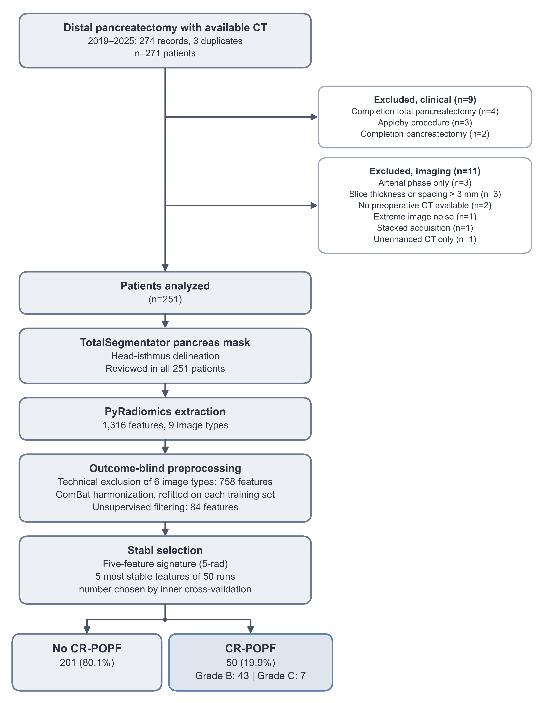
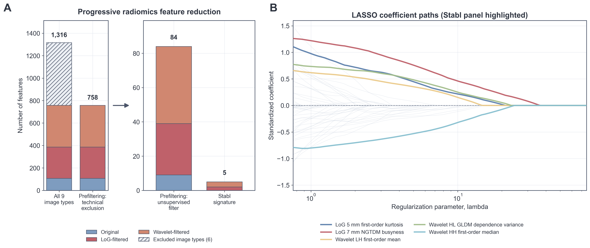
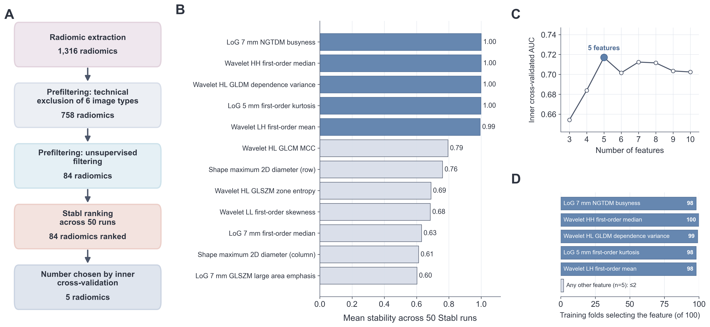
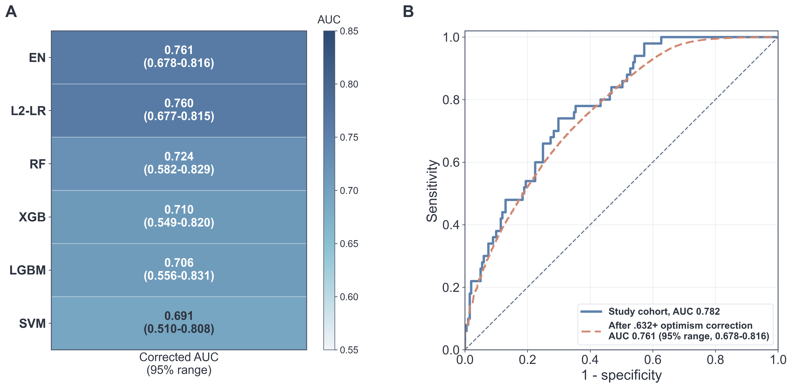
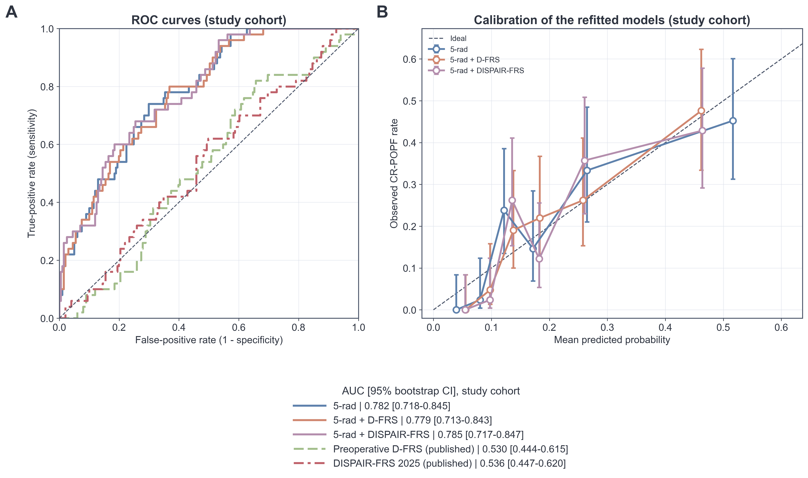
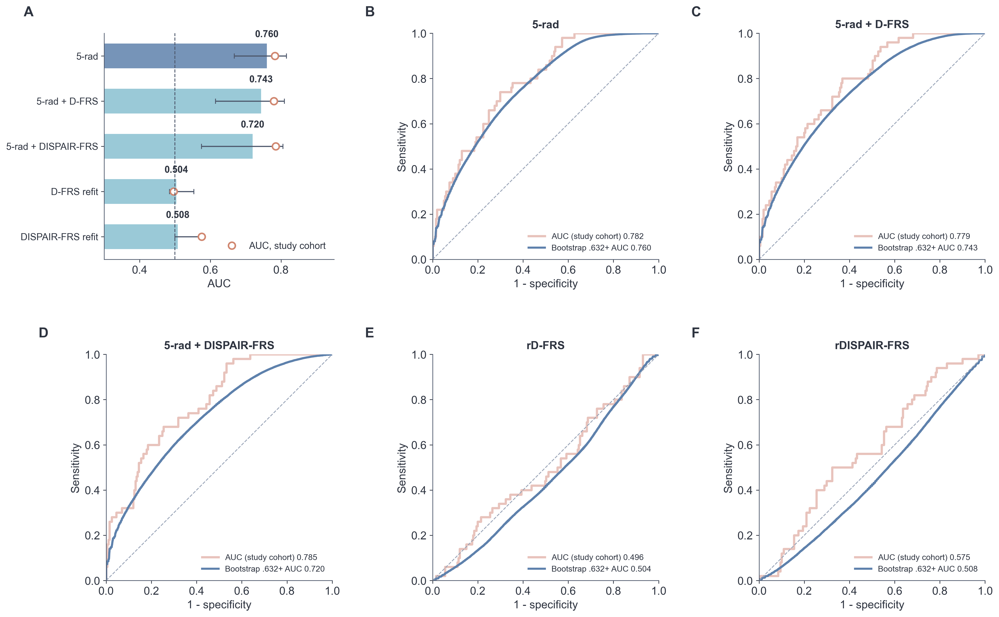
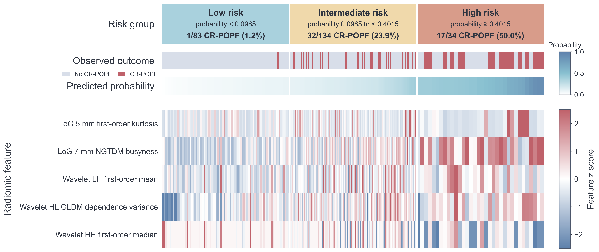

# 5-rad pipeline: detailed description

Code, de-identified data and results of the study *Preoperative Prediction of Postoperative Pancreatic Fistula After Distal
Pancreatectomy Using a Sparse Radiomic Signature of the Pancreatic Remnant* (Department of HPB Surgery and Liver
Transplantation and Department of Radiology, Beaujon Hospital, AP-HP, Clichy, France).

**Question.** Do radiomic features of the future pancreatic remnant (head and isthmus) on preoperative portal venous CT
predict a clinically relevant postoperative pancreatic fistula (CR-POPF, ISGPS 2016 grade B or C) after distal
pancreatectomy?

**Answer.** In this cohort, a signature of five radiomic features of the head-isthmus region, combined in an elastic-net
logistic regression (5-rad), discriminated CR-POPF better than the D-FRS and the DISPAIR-FRS. The model needs external
validation before any clinical use.

## Main results

251 patients operated on in 2019–2025, 50 CR-POPF (19.9%; grade B 43, grade C 7).

| Estimate | AUC (95% interval) |
|---|---|
| 5-rad, study cohort | 0.782 (0.718–0.845) |
| 5-rad, bootstrap .632+ (fixed signature, 2,000 samples) | 0.761 (0.678–0.816) |
| 5-rad, nested cross-validation (feature selection repeated in every training fold) | 0.745 (0.677–0.806) |
| 5-rad, nested cross-validation, number of features also chosen in every training fold | 0.718 (0.656–0.780) |
| D-FRS, published preoperative equation | 0.530 (0.444–0.615) |
| DISPAIR-FRS 2025, published equation | 0.536 (0.447–0.620) |

Intervals: patient bootstrap 95% CI for the apparent AUC of 5-rad and the published scores; 2.5th–97.5th
percentiles of the 2,000 bootstrap estimates for the .632+ AUC; bootstrap 95% CI of the mean over repeats for the nested
AUCs.

Calibration of 5-rad: intercept 0.00, slope 1.00 (study cohort); optimism-corrected slope 0.83 (95% range 0.56–1.16).

| Risk group (5-rad probability) | CR-POPF, study cohort | CR-POPF rate, left-out patients |
|---|---|---|
| Low, < 0.0985 (rule-out) | 1/83 (1.2%) | 3.1% (0.0–13.7) |
| Intermediate, 0.0985 to < 0.4015 | 32/134 (23.9%) | 23.1% (15.0–31.4) |
| High, ≥ 0.4015 (rule-in) | 17/34 (50.0%) | 47.1% (14.3–100.0) |

Left-out patients: model and cutpoints refitted in each of 2,000 bootstrap samples and applied to the patients left out of
that sample (median and 95% interval over the samples; Supplementary Table 4). The cutpoints are internal and exploratory.
They were assessed by nested bootstrap (section 11), not in an external cohort.

## Pipeline



*Figure 1. Cohort and workflow.*

### 1. Cohort and outcome

274 records of distal pancreatectomy with an available CT (2019–2025) correspond to 271 patients; 3 records were duplicates.
20 patients were excluded:

- Clinical (9): 3 Appleby procedures (distal pancreatectomy with celiac axis resection), 4 completion total pancreatectomies and 2 completion pancreatectomies.
- Imaging (11): 3 arterial phase only, 3 slice thickness or spacing > 3 mm, 2 with no preoperative CT available, 1 extreme image noise, 1 stacked acquisition, 1 unenhanced CT only. In each case, the parenchyma could not be measured on the same footing as in the other patients.

251 patients were analyzed. The outcome is CR-POPF, ISGPS 2016 grade B or C:

- 107 had no fistula;
- 94 had a biochemical leak;
- 43 had grade B;
- 7 had grade C.

The 251 patients form one cohort. No analysis separates them by period or scanner.

### 2. Region of interest: the future remnant

TotalSegmentator v2 segmented the pancreas on the portal venous phase. Two abdominal radiologists reviewed every mask and
delineated the head-isthmus region, the part of the gland left in place by a distal pancreatectomy. In one patient whose
automatic pancreas mask was incomplete, the pancreas was segmented again with the full TotalSegmentator model and the region
was taken on the head side of the transection plane. Median volume: 31.9 mL (IQR 26.1–40.8).

The target is the remnant because a fistula after distal pancreatectomy comes from the stump. The body and tail are removed
at the operation.

### 3. Feature extraction

PyRadiomics, settings in [`extraction/radiomics_params.yaml`](extraction/radiomics_params.yaml):

- texture on native axial slices (2D), 1 mm in-plane B-spline resampling, slice spacing kept;
- fixed bin width of 25 (HU on the original image), no intensity normalization;
- seven feature classes (shape, first order, GLCM, GLRLM, GLSZM, GLDM, NGTDM);
- image types: Original, Laplacian of Gaussian (σ 3, 5 and 7 mm), wavelet (Haar, 4 sub-bands).

Mask preparation: largest connected component, then CT and mask cropped to the mask plus a 40 mm margin
([`extraction/extract_features.py`](extraction/extract_features.py)).

In-plane pixels measure 0.59–0.98 mm and slices 0.625–3 mm. 3D texture would mix neighbors at very different distances and
need interpolation across slices; texture matrices computed slice by slice avoid both. Only the texture matrices are 2D:
PyRadiomics applies the LoG filter in 3D (hence `3D` in the feature names).

CT numbers are calibrated, so a fixed bin width keeps the same meaning in every patient. At 25 HU, the head-isthmus mask
holds a median of 13 gray levels (IQR 12–15): enough for texture matrices without making them sparse.

Check: `extract_features.py` with these settings reproduces `data/radiomics.csv` within a relative difference of
7×10⁻¹³ in four patients, two for each type of mask (on the CT grid, or resampled onto it).

### 4. Six image types excluded before any modeling (1,316 → 758 features)

The analyzed image types (original, Laplacian of Gaussian and wavelet) were fixed in the extraction configuration before any
analysis. All nine image types available in 2D were nevertheless extracted, 1,316 features, to check the six others on
technical grounds, blind to the outcome.

| Image type | Features | Decision | Reason | Check, 251 patients |
|---|---|---|---|---|
| Original | 107 (14 shape) | kept | calibrated HU | 13 gray levels in the mask (median) |
| Laplacian of Gaussian, σ 3, 5, 7 mm | 279 | kept | spatial filter at a defined scale | |
| Wavelet (Haar), 4 sub-bands | 372 | kept | spatial filter at a defined scale | |
| Square | 93 | excluded | voxel-wise remapping scaled by the most extreme voxel of the image | 2 gray levels (median); 99.7% of mask voxels in one bin |
| Exponential | 93 | excluded | as square | 1 gray level in 94% of patients (≤ 3 in 97%) |
| Square root | 93 | excluded | voxel-wise remapping scaled by the most extreme voxel: a bin no longer spans a fixed HU interval | scaling value 216–3,936 HU, set by air (59%) or by bone or contrast (41%) outside the pancreas; the bin containing 100 HU spans 8.1–34.6 HU |
| Logarithm | 93 | excluded | as square root | the bin containing 100 HU spans 5.2–67.5 HU |
| Gradient magnitude | 93 | excluded | unsmoothed derivative without a defined spatial scale, largely redundant with the LoG and wavelet features | 6 gray levels (median); 77% of features with \|ρ\| > 0.80 against an analyzed feature |
| Local binary patterns | 93 | excluded | categorical codes (0–9), not intensities | 3 features constant by construction |

The four intensity transforms rescale each image by its most extreme voxel, which lies outside the pancreas: air in 59% of
patients, bone or contrast in 41%. The same pancreatic tissue then falls in different bins from one patient to the next, and
the fixed bin width loses its meaning. The gradient magnitude has no spatial scale and is largely redundant with the
analyzed features. LBP codes are labels, not intensities.

The checks are in [`results/image_type_checks/`](results/image_type_checks):

- `intensity_checks.csv`: scaling value and gray levels per patient, computed from the CT images by `extraction/intensity_checks.py`.
- `redundancy.csv`: largest |ρ| with an analyzed feature, from `analysis/02b_image_type_redundancy.py`.
  - 43% of the 555 informative excluded features have |ρ| > 0.80 with an analyzed feature.
  - With the excluded types included, the prefilter would keep 136 candidates instead of 84.

### 5. Harmonization across scanners (ComBat)

neuroCombat harmonizes the features by reconstruction-protocol batch:

| Batch | Patients |
|---|---|
| GE standard (reference) | 166 |
| GE thin | 27 |
| Siemens soft/medium | 25 |
| Philips | 11 |
| Other | 22 |

Shape features are not harmonized: they depend on the mask, not on intensities.

- In every bootstrap refit and every outer cross-validation fold of sections 8 to 10, ComBat is fitted on the training rows and applied to the held-out rows. Held-out rows of a protocol absent from the training rows are left unharmonized.
- The inner refits of section 11 reuse the outer harmonization.
- Hyperparameter tuning inside a training sample uses the features harmonized for that sample.
- The final model uses ComBat fitted on all patients.

Texture depends on the vendor, reconstruction kernel and dose. The 251 CTs come from 28 scanner models of four vendors (GE,
Siemens, Philips, Canon/Toshiba; Supplementary Table 1). ComBat removes the shift in location and scale between batches while
keeping the variation between patients. The largest batch is the reference and keeps its own scale.

### 6. Outcome-blind prefilter (758 → 84 features)

On the harmonized training data ([`src/common.py`](src/common.py), `prefilter`):

1. drop features missing in more than 30% of patients (none);
2. drop features with an unstandardized variance ≤ 0.01 (758 → 506);
3. take the pairs with Spearman |ρ| > 0.80 in order; when both members are still present, drop the one with the smaller variance (506 → 84).

Features are never merged or averaged: each of the 84 candidates is an unmodified PyRadiomics feature (29 first-order, 6
shape and 49 texture features; 9 from the original image, 30 LoG and 45 wavelet), and no two of them correlate above 0.80.

Stabl counts how often each feature is selected. With near-duplicates, the selections are shared between twins and both
rank low; removing twins first leaves one representative per signal. The filter never sees the outcome. In the nested
cross-validation it is refitted in every training fold.

### 7. Feature selection with Stabl (84 → 5 features)



*Supplementary Figure 2. A, feature reduction by family. B, LASSO coefficient paths of the 84 candidates (signature features highlighted).*

Stabl (Hédou et al., *Nat Biotechnol* 2024) is stability selection against artificial decoys. In each run:

- every real feature gets a randomly permuted copy (decoy), which competes with it in every fit;
- an L1-penalized logistic regression (randomized LASSO, weakness 0.5, balanced class weights) is fitted on 1,000 class-balanced subsamples of 75% of the patients, over the automatic grid of penalties;
- the stability of a feature is its largest selection frequency over the penalty grid.

[`src/fast_stabl.py`](src/fast_stabl.py) is a compiled (numba) implementation. It takes the penalty grid, the decoys and the
subsamples from the official Stabl code ([`src/stabl_official.py`](src/stabl_official.py)).

Stabl was run 50 times on all patients, and the features were ranked by mean stability. The number of features was chosen by
inner cross-validation on all patients ([`src/panel_size.py`](src/panel_size.py)): stratified 5-fold cross-validation
repeated 10 times; in every inner training part, ComBat, the prefilter, Stabl (5 runs) and an elastic net on the k most
stable features (k = 3 to 10; Optuna, 50 trials, patient-grouped 5-fold cross-validation repeated twice) are refitted, and the
k with the highest pooled inner AUC is kept (the smallest on ties).

| k | 3 | 4 | 5 | 6 | 7 | 8 | 9 | 10 |
|---|---|---|---|---|---|---|---|---|
| Inner cross-validated AUC | 0.654 | 0.684 | **0.717** | 0.702 | 0.712 | 0.712 | 0.703 | 0.702 |

The signature is the five most stable features:

| Feature | Mean stability |
|---|---|
| LoG 7 mm NGTDM busyness | 1.00 |
| Wavelet HH first-order median | 1.00 |
| Wavelet HL GLDM dependence variance | 1.00 |
| LoG 5 mm first-order kurtosis | 1.00 |
| Wavelet LH first-order mean | 0.99 |

The next features ranked well below (wavelet HL GLCM maximal correlation coefficient 0.79, shape maximum 2D diameter (row)
0.76). All five describe the parenchyma on filtered images (LoG or wavelet).

With 50 events and correlated features, the LASSO picks different features from one sample to the next. Counting selections
over 1,000 subsamples, with permuted copies competing in every fit, keeps the features that are selected consistently.

Stabl's own data-driven threshold was not used ([`analysis/03b_stabl_threshold.py`](analysis/03b_stabl_threshold.py)). With
these settings it retained no feature in 47 of the 50 runs: in this correlated feature space, the permuted decoys were
selected more often than most real features (median stability 0.69 vs 0.20). With the package defaults (subsamples of 50%,
plain L1 regression, 10 runs), it retained 2 to 4 features per run.



*Supplementary Figure 1. A, selection steps. B, mean stability over 50 Stabl runs. C, inner cross-validated AUC by number of
features. D, number of the 100 nested training folds (section 9) selecting each signature feature and the most selected other
feature.*

### 8. Model: elastic-net logistic regression

The model is an unweighted elastic-net logistic regression on the five z-scored features.

- Hyperparameters: C (log-uniform, 10⁻³ to 10²) and l1_ratio (0 to 1).
- Tuning: Optuna (TPE, 100 trials) on the mean AUC of a patient-grouped stratified 5-fold cross-validation repeated 10 times.
- Five Optuna runs with seeds 7, 11, 13, 17 and 19; the seed also sets the cross-validation split. The run with the best cross-validated AUC is kept and refitted on all patients.
- Final values: C = 22.4 and l1_ratio = 0.21.

| Term (per SD of the feature) | Coefficient |
|---|---|
| Intercept | −1.708 |
| LoG 5 mm first-order kurtosis | 0.540 |
| LoG 7 mm NGTDM busyness | 0.798 |
| Wavelet LH first-order mean | 0.491 |
| Wavelet HL GLDM dependence variance | 0.488 |
| Wavelet HH first-order median | −0.775 |

Feature means and SDs for the z-scores are in [`results/tables/table2.csv`](results/tables/table2.csv). The fitted model
is in [`results/final_model/model.json`](results/final_model/model.json).

A penalized linear model gives an equation that can be written down and checked, and it tolerates the remaining correlation
between features. The other families were tuned on fixed grids by 3-fold cross-validation in every bootstrap sample and
evaluated on the same samples (bootstrap .632+, Figure 3A). They did not improve discrimination with five features and 50
events:

| Family | .632+ AUC (95% range) |
|---|---|
| Elastic net (final) | 0.761 (0.678–0.816) |
| L2 logistic regression | 0.760 (0.677–0.815) |
| Random forest | 0.724 (0.582–0.829) |
| XGBoost | 0.710 (0.549–0.820) |
| LightGBM | 0.706 (0.556–0.831) |
| SVM | 0.691 (0.510–0.808) |

Sensitivity analysis of the tuning criterion ([`analysis/05b_model_choice.py`](analysis/05b_model_choice.py)).

- The elastic net was tuned on the cross-validated log-loss instead of the AUC, by grid search: C from 10⁻³ to 10³, l1_ratio 0, 0.1, 0.25, 0.5, 0.75 or 1.
- It chose l1_ratio = 0 in every fold, which is an L2-penalized logistic regression.
- Nested cross-validation of the tuning step, signature fixed, outer 5-fold repeated 20 times; log-loss tuning vs AUC tuning:
  - AUC 0.758 vs 0.760;
  - log-loss 0.438 vs 0.441 (lower in every repeat);
  - calibration slope 0.86 vs 0.74.

Discrimination does not change. Tuning on the log-loss gives better-calibrated probabilities. The reported model stays the
elastic net tuned on the AUC.



*Figure 3. A, bootstrap .632+ AUC of the model families on the signature. B, ROC curve of 5-rad in the study cohort and the
.632+-corrected curve.*

### 9. Internal validation

**Bootstrap .632+, fixed signature** ([`analysis/06_bootstrap_validation.py`](analysis/06_bootstrap_validation.py)).

2,000 class-stratified bootstrap samples. In each sample, ComBat, scaling and the full Optuna tuning are redone on the in-bag
patients, with the five features fixed. The .632+ estimator (Efron and Tibshirani, 1997) weighs the in-bag AUC (mean 0.788)
against the out-of-bag AUC (mean 0.753) and corrects for overfitting. The .632+ AUC was 0.761 (95% range 0.678–0.816), and
0.760 in a replication series with another seed.

This estimates the optimism of fitting the fixed signature. The optimism-corrected calibration slope (Harrell) is 0.83
(95% range 0.56–1.16).

**Nested cross-validation of the whole pipeline** ([`analysis/09_nested_cv.py`](analysis/09_nested_cv.py)).

Every data-driven step is redone inside each training fold:

1. ComBat;
2. the prefilter;
3. Stabl (50 runs × 1,000 subsamples);
4. the five most stable features;
5. the elastic net tuned as the final model.

The held-out fold is then predicted. 10-fold cross-validation repeated 10 times, 100 training folds: AUC 0.745
(0.677–0.806).

Stricter version: the number of features is also chosen inside each training fold, by the inner cross-validation of
section 7 (5-fold × 2 repeats of the training fold). AUC 0.718 (0.656–0.780); number of features chosen: median 6 (IQR 5–8).

With a fixed number of features k, the nested AUC was 0.642, 0.683, 0.745, 0.731, 0.725, 0.717, 0.715 and 0.708 for
k = 3 to 10.

These estimate the cost of choosing features on 50 events. The gap from 0.761 to 0.745 (and 0.718) reflects feature
selection; the estimators also differ. The manuscript reports these estimates.

How often each signature feature was selected again across the 100 training folds (Supplementary Figure 1D):

| Feature | Selected again |
|---|---|
| Wavelet HH first-order median | 100% |
| Wavelet HL GLDM dependence variance | 99% |
| LoG 7 mm NGTDM busyness | 98% |
| LoG 5 mm first-order kurtosis | 98% |
| Wavelet LH first-order mean | 98% |

The whole signature was selected again in 94% of the training folds; no other feature was selected in more than 2.

### 10. Comparison with published clinical scores



*Figure 4. A, apparent ROC curves of 5-rad, the radioclinical refits and the published scores. B, apparent calibration.*

Published equations, applied without refit ([`analysis/08_clinical_comparison.py`](analysis/08_clinical_comparison.py)):

- the preoperative D-FRS (De Pastena, *Ann Surg* 2023): main pancreatic duct diameter and pancreatic neck thickness;
- the 2025 DISPAIR-FRS (Bonsdorff, *Br J Surg* 2025): age with cubic spline terms, sex, duct diameter, neck thickness and transection site. Neck transection was assumed for every patient.

Both measurements come from the preoperative CT:

- neck thickness at the transection plane, neck only (uncinate process excluded);
- main pancreatic duct diameter at the isthmus, in the plane of the neck-thickness measurement: full width at half contrast across the duct, or a manual caliper; each measurement was reviewed on the images. Ducts not resolved on CT (contrast-to-noise ratio < 4; 77 patients) were coded 1 mm, and the diameter of the operative report was used when the review was inconclusive (17 patients); `mpd_source` in `data/clinical.csv` gives the source of each value.

| Model | Apparent AUC (95% CI) | DeLong P vs 5-rad |
|---|---|---|
| 5-rad | 0.782 (0.718–0.845) | |
| 5-rad + D-FRS covariates | 0.779 (0.713–0.843) | .515 |
| 5-rad + DISPAIR-FRS covariates | 0.785 (0.717–0.847) | .808 |
| rD-FRS (refitted) | 0.496 (0.409–0.585) | < .001 |
| rDISPAIR-FRS (refitted) | 0.575 (0.491–0.661) | < .001 |
| D-FRS (published) | 0.530 (0.444–0.615) | < .001 |
| DISPAIR-FRS 2025 (published) | 0.536 (0.447–0.620) | < .001 |

The refits use the covariates of each score, alone (rD-FRS, rDISPAIR-FRS: unpenalized logistic regressions, maximum
likelihood) or with the five radiomic features (5-rad + D-FRS covariates, 5-rad + DISPAIR-FRS covariates: elastic nets tuned
as the final model). In rD-FRS, the odds ratio per mm was 0.95 (95% CI 0.75–1.20) for the duct diameter and 1.01
(0.96–1.06) for neck thickness
([`results/clinical_comparison/clinical_refit_coefficients.csv`](results/clinical_comparison/clinical_refit_coefficients.csv)).
CR-POPF occurred in 17% of patients with a duct below 1.5 mm, 24% from 1.5 to < 2.5 mm, 26% from 2.5 to < 4 mm and 11% at
4 mm or more, a relation that a linear term does not capture.

The DeLong tests compare apparent predictions and are descriptive: the refits are scored on the patients they were fitted
to. The fair comparison is the .632+ AUC over the same 2,000 bootstrap samples (Supplementary Figure 3), in which every
fitted model, 5-rad included, is refitted in bag (elastic nets: one Optuna run per refit; logistic regressions: maximum
likelihood):

| Model | .632+ AUC | Paired difference vs 5-rad | P |
|---|---|---|---|
| 5-rad | 0.760 | | |
| 5-rad + D-FRS covariates | 0.743 | 0.016 | .29 |
| 5-rad + DISPAIR-FRS covariates | 0.720 | 0.040 | .25 |
| rD-FRS | 0.504 | 0.256 | .001 |
| rDISPAIR-FRS | 0.508 | 0.252 | .002 |
| D-FRS (published) | 0.528 | 0.231 | .005 |
| DISPAIR-FRS 2025 (published) | 0.532 | 0.227 | .003 |

Sensitivity analysis with the duct diameter of the operative report (`mpd_operative`; apparent AUC, DeLong P vs 5-rad):
D-FRS 0.566 (0.478–0.652), P < .001; DISPAIR-FRS 0.528 (0.439–0.616), P < .001; rD-FRS 0.614 (0.522–0.701), P = .002;
rDISPAIR-FRS 0.596 (0.508–0.676), P < .001; 5-rad + D-FRS covariates 0.782, P = .948; 5-rad + DISPAIR-FRS covariates
0.788, P = .615 ([`results/clinical_comparison/sensitivity_operative_mpd.csv`](results/clinical_comparison/sensitivity_operative_mpd.csv)).

These are the published preoperative scores for distal pancreatectomy. In this cohort they discriminated poorly, whichever
duct diameter was used, and adding their covariates to 5-rad did not improve discrimination.



*Supplementary Figure 3. A, bootstrap .632+ AUC (bars, with 95% range) and apparent AUC (circles). B–F, apparent and
.632+-weighted ROC curves of each fitted model.*

### 11. Risk groups: rule-out and rule-in cutpoints



*Figure 5. Patients ordered by 5-rad probability: risk group, observed outcome and z-scores of the five features.*

The cutpoints maximize the Matthews correlation coefficient (MCC) under a constraint:

- rule-out: highest MCC with sensitivity ≥ 90%;
- rule-in: highest MCC with specificity ≥ 90%.

They were chosen on a grid of step 0.0005, on the out-of-bag predictions pooled over the 2,000 bootstrap refits of section 9.
In that pool, every patient is scored only by models fitted without that patient. Result: 0.0985 and 0.4015. Applied to the
final model, they give the three groups of the main results (Supplementary Table 4).

Cutpoints picked on apparent predictions inherit the model's optimism; pooled out-of-bag predictions approximate predictions
for new patients.

Nested bootstrap validation of the rule ([`analysis/10_nested_cutpoints.py`](analysis/10_nested_cutpoints.py)).
In each of the 2,000 outer samples, 5-rad is refitted in bag as in section 9 and the rule is redone on the in-bag patients:

1. 500 inner bootstrap refits of the elastic net, with the outer hyperparameters on the outer-harmonized features;
2. their pooled out-of-bag predictions;
3. the constrained MCC.

The cutpoints are then applied to the outer out-of-bag patients:

- Rule-out: sensitivity 94.0% (mean; median 95.0%); NPV 96.9% (median).
- Rule-in: specificity 92.5% (mean; median 92.9%); PPV 47.1% (median).
- The 90% target was met in 75.9% (rule-out) and 69.6% (rule-in) of the outer samples.
- Pooled out-of-bag CR-POPF rate by group: 4.1%, 23.0% and 45.2%.
- Per outer sample (medians; Supplementary Table 4, [`analysis/10b_cutpoint_sensitivity.py`](analysis/10b_cutpoint_sensitivity.py)): the low-risk group held 29.3% of the left-out patients, with a CR-POPF rate of 3.1% and 5.0% of all CR-POPF; the high-risk group 11.2%, 47.1% and 25.0%.

Sensitivity analyses of the rule (`results/key_numbers.json`, `cutpoints`; `results/nested_cutpoints/`; `results/cutpoint_sensitivity/`):

- the same rule on the apparent predictions of the final model gives 0.105 and 0.515 (CR-POPF 1/87, 38/149 and 11/15); rule-out sensitivity 98.0% in the study cohort, 94.1% after optimism correction and 88.9% in left-out patients (median), against 98.0%, 96.9% and 95.0% for the reported cutpoints;
- the medians of the cutpoints chosen in each bootstrap sample give 0.111 and 0.438 (CR-POPF 4/97, 33/131 and 13/23);
- in the nested validation, these medians and cutpoints chosen once on the in-bag predictions met the rule-out sensitivity target in 41% and 45% of the outer samples, against 76% for the pooled out-of-bag rule; the rule-in specificity target in 73% and 66%, against 70%;
- targets of 80%, 85% and 95% instead of 90%: cutpoints 0.1325/0.2620, 0.1145/0.3180 and 0.0820/0.5345; CR-POPF in the low-risk group 9/117, 5/98 and 0/65; in the nested validation, the rule-out target was met in 74.0%, 74.8% and 82.0% of the outer samples and the rule-in target in 73.0%, 71.0% and 70.4%;
- 500 inner samples are enough: in the first 50 outer samples, the medians from 2,000 inner samples differ from those from 500 by a median of 0.001 (rule-out) and 0.002 (rule-in).

These groups can frame prospective studies of drain management or surveillance. They should not be used to decide on
drainage or early drain removal.

## Data

The data are de-identified tables derived from the preoperative CT examinations (radiomic features, scanner metadata) and from
the institutional clinical database (clinical variables, fistula grade). No images are included.

All files are in `data/` and are checked against `data/SHA256SUMS` at every load. One row per patient. The row order is the
order of the analysis: it defines the cross-validation folds and bootstrap samples.

| File | Content |
|---|---|
| `cohort.csv` | `patient_id`, `cr_popf` (0/1), `popf_grade` (NO, BL = biochemical leak, B, C), `combat_batch` (reconstruction-protocol batch) |
| `clinical.csv` | clinical variables below |
| `scanners.csv` | manufacturer, model, kVp, exposure time (ms), tube current (mA), slice thickness and pixel spacing (mm) |
| `radiomics.csv` | the 758 analyzed features (PyRadiomics names: image type, feature class, feature) |
| `excluded_image_types.csv` | the 558 features of the six excluded image types (section 4) |
| `flow.json` | counts of the flow chart (Figure 1) |

`clinical.csv` holds 0/1 flags unless a unit is given.

- Patient: `age` (years), `bmi` (kg/m²), `male`, `diabetes`, `alcohol`, `tobacco`, `asa3` (ASA ≥ 3).
- Lesion: `lesion_size` (mm); `lesion_head`, `lesion_body`, `lesion_tail`, `lesion_isthmus` (location); `pathology` (category).
- Measurements: `neck_thickness` (mm, CT, at the transection plane, neck only); `mpd` (main pancreatic duct diameter, mm, CT at the isthmus, section 10); `mpd_operative` (duct diameter of the operative report, mm; 1 mm when not described, an explicit 0 kept); `mpd_source` (source of `mpd`: CT; CT, not resolved, coded 1 mm; operative report).
- Operation: `mis` (minimally invasive approach), `op_time` (min), `blood_loss` (mL), `transfusion`, `soft` (soft pancreas), `stapler` (stapled transection), `wirsung_suture` (selective duct suture), `drain` (operative drain), `spleen_preserved`, `vessels_preserved` (splenic vessels), `somatostatin`.
- Postoperative: `mortality`, `clavien3` (Clavien–Dindo ≥ III), `any_popf` (biochemical leak or grade B/C), `popf_collection` (fistula-related collection), `antibiotics`, `collection_drained`, `drain_bedside`, `drain_radiological`, `drain_endoscopic`, `drain_surgical` (reoperation or surgical drainage), `prolonged_drainage` (> 3 weeks).

De-identification:

- Patients carry random identifiers (P001–P251). The key to the hospital records stays with the investigators, outside this repository.
- No names, hospital identifiers or dates are included.
- The flow chart holds counts only.
- CT images and segmentation masks are not shared.
- One age recorded to the day is given to one decimal. The results in `results/` were computed with the exact ages; with the shared values, `08_clinical_comparison.py` gives the same apparent AUCs to four decimals and .632+ values within 0.001, and, in the sensitivity analysis with the operative-report duct diameter, 0.789 instead of 0.788 for 5-rad + DISPAIR-FRS covariates.

## Reproduce

```sh
pip install -r requirements.txt   # Python 3.12; exact versions: requirements-lock.txt
./run_all.sh                       # WORKERS=12 BOOTSTRAPS=2000 by default
```

All seeds are fixed. With 13 workers, the longest steps took about 7 hours (bootstrap validation, 06), 5 hours (nested
cross-validation, 09) and 2 hours (nested validation of the cutpoints, 10); most steps record their run time in their
`summary.json`.

- The nested cross-validation stages are cached in `results/nested_cv/`, keyed to the checksums of `data/cohort.csv` and `data/radiomics.csv` and to the command-line settings. `run_all.sh` resumes from this cache.
- To recompute them, delete `results/nested_cv/*fold.json`; delete them also after any change to the code.
- Running `09_nested_cv.py` with non-default `--runs`, `--trials` or `--inner-*` settings also discards the cache.

Rerunning the scripts on `data/` reproduces `results/`: identical tables, figures, final model, Stabl selection and nested
cross-validation; the other resampling analyses run the same code with the same seeds. The two rounded ages are the only
difference (above).

### Docker

```sh
docker build -t remnant-radiomics-popf .
docker run --rm --user "$(id -u):$(id -g)" -v "$PWD/results:/repo/results" remnant-radiomics-popf   # every analysis
docker run --rm --user "$(id -u):$(id -g)" -v "$PWD/results:/repo/results" remnant-radiomics-popf python3 analysis/05_final_model.py
```

The image pins the Python base image by digest and every Python package (`requirements-lock.txt`). The long resampling
analyses can differ in the last digits from one platform to another. Figures fall back to DejaVu Sans when Arial is not
installed.

### Feature extraction

Feature extraction needs the CT images, which are not shared:

```sh
python3 extraction/extract_features.py cases.csv features.csv   # cases.csv: patient_id, ct, mask (NIfTI paths)
```

It also needs PyRadiomics (commit 9b1e030), SimpleITK 2.4.0, PyYAML 6.0.2 and scikit-image 0.24.0 (local binary patterns).

## Layout

| Path | Content |
|---|---|
| `data/` | de-identified inputs |
| `extraction/` | PyRadiomics settings, feature extraction and image-type checks (need CT images) |
| `src/` | ComBat, prefilter, Stabl, elastic net, bootstrap, calibration, DeLong test, cutpoints |
| `analysis/` | one script per analysis, run in order by `run_all.sh` |
| `results/` | tables, figures, `key_numbers.json` and the outputs of each analysis |
| `Dockerfile`, `requirements-lock.txt` | analysis environment |
| `LICENSE` | code license (MIT) |
| `CITATION.cff`, `.zenodo.json` | citation and archive metadata |

| Script | Manuscript item |
|---|---|
| `01_table1.py` | Table 1 |
| `02_scanner_table.py` | Supplementary Table 1 |
| `02b_image_type_redundancy.py` | redundancy check of the six excluded image types (section 4) |
| `03_feature_selection.py` | Stabl on all patients, number of features by inner cross-validation, the 5-rad signature; Supplementary Figures 1 and 2A |
| `03b_stabl_threshold.py` | Stabl's own threshold on these data (section 7) |
| `04_lasso_paths.py` | Supplementary Figure 2B |
| `05_final_model.py` | final model, apparent AUC and calibration; Table 2 |
| `05b_model_choice.py` | sensitivity analysis of the tuning criterion |
| `06_bootstrap_validation.py` | .632+ AUC, optimism-corrected slope, cutpoints; Figure 3B |
| `07_model_families.py` | Figure 3A |
| `08_clinical_comparison.py` | D-FRS, DISPAIR-FRS, clinical-only refits (unpenalized logistic regressions) and radioclinical refits, sensitivity analysis with the operative-report duct diameter; Figure 4, Supplementary Figure 3 |
| `09_nested_cv.py` | nested cross-validation |
| `10_nested_cutpoints.py` | nested bootstrap validation of the cutpoints |
| `10b_cutpoint_sensitivity.py` | risk groups in left-out patients (Supplementary Table 4), sensitivity analyses of the cutpoints |
| `11_figures.py` | Figures 1, 3, 4, 5 and Supplementary Figures 1–3 |
| `12_tables.py` | Table 2, Supplementary Table 4, `results/key_numbers.json` |

Figure 2 of the manuscript (segmentation examples on CT images) is not part of this repository.

## Third-party code

- `src/stabl_official.py`: subsample generator, decoy features and penalty grid copied from Stabl (https://github.com/gregbellan/Stabl, commit 1d07f85), Clear BSD License; the notice is in the file.
- Dependencies, not bundled: PyRadiomics, neuroCombat, scikit-learn, Optuna, numba, XGBoost and LightGBM.
- Segmentation used TotalSegmentator v2, which is not part of this repository.

## Limitations

- Single-center, retrospective study with 50 events; no external validation.
- The nested estimates (0.745, and 0.718 when the number of features is also chosen in every training fold) are lower than the .632+ estimate (0.761).
- The head-isthmus region is delineated manually on an automatic mask, so the workflow is semi-automatic.
- The duct could not be resolved on CT in 77 patients, coded 1 mm.
- The DISPAIR-FRS was applied with neck transection assumed for all patients.
- The cutpoints are internal, and their out-of-bag intervals are wide.

## License

- Code: MIT License (`LICENSE`), except `src/stabl_official.py` (Clear BSD License, notice in the file).
- Data and results (`data/`, `results/`): de-identified patient data from AP-HP, shared to reproduce the published analyses. Any other use requires the agreement of the authors and of AP-HP.

## Citation

Article reference to be added on publication. Citation metadata of this repository: [`CITATION.cff`](CITATION.cff).
